# 🔥 Stubble-Burning Early Warning System — Punjab, India

**A satellite-data + machine-learning prototype that forecasts crop-residue (stubble) burning 15 days ahead,
validates it with Sentinel-2 imagery, shows it on a live dashboard and e-mails alerts to stakeholders.**

 
 
 


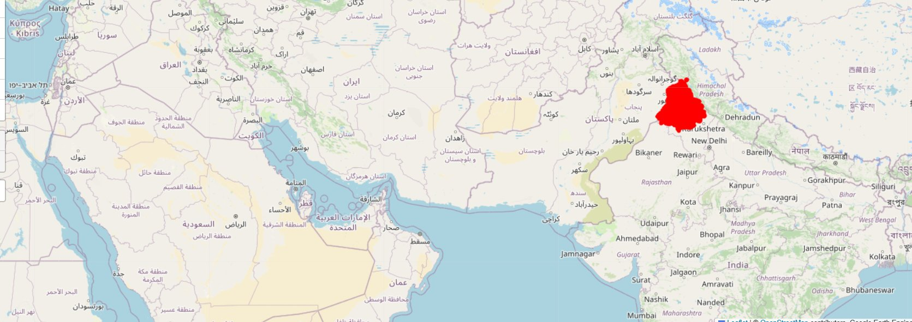

---

## 📑 Contents
1. [Problem statement & research questions](#-problem-statement--research-questions)
2. [System architecture](#-system-architecture)
3. [Data & satellite sources](#-data--satellite-sources)
4. [Methodology](#-methodology)
5. [Results](#-results)
6. [Screenshots](#-screenshots)
7. [Repository structure](#-repository-structure)
8. [Quick start](#-quick-start)
9. [Limitations (read this)](#-limitations-read-this)
10. [Future work](#-future-work) · [References](#-references) · [Credits](#-credits--licence)

## 🎯 Problem statement & research questions
Stubble burning in Punjab and Haryana is a major seasonal source of air pollution in North India. Per the project
presentation, India produces ~500 Mt of crop residue a year, ~100 Mt of it burned, and burning is said to contribute up
to 40 % of winter air pollution in Delhi-NCR *(figures as stated in the deck; primary sources still to be added)*.
Fires are usually detected only **after** ignition.

**Problem.** *Can multi-sensor satellite data forecast, 15 days ahead and at ~5-36 km² hexagon level, where
stubble fires will occur, and how should an alert threshold be set when fires are very rare events?*

| # | Research question | Where answered |
|---|---|---|
| RQ1 | How well does fire history from NASA FIRMS forecast fires in the next 15 days under a strictly forward-in-time evaluation? | `src/stubble_ews/`, `docs/ML_PIPELINE.md` |
| RQ2 | With very imbalanced classes, which operating threshold balances recall (catch fires) against false alarms (field-team workload)? | F2 threshold search, PR curves |
| RQ3 | Do independent Sentinel-2 burn signals (NBR/dNBR) confirm the predicted hot-spots? | `gee/`, Sentinel-2 maps below |
| RQ4 | Can predictions reach decision-makers automatically? | Streamlit dashboard + Gmail alerts |

## 🏗 System architecture
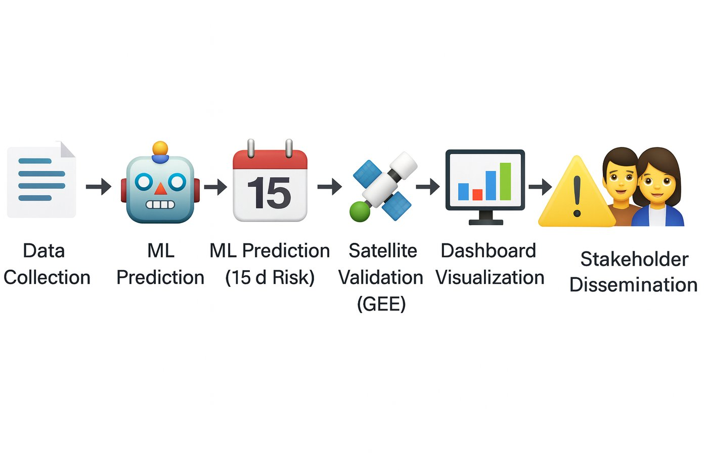

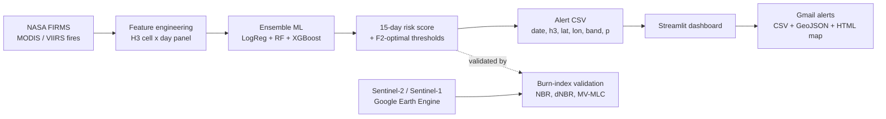
The original project flowchart (two models → data processing → features → train/test → prediction → dashboard + alerts):

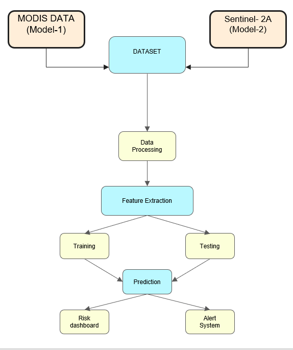

## 🛰 Data & satellite sources
| Source | Role |
|---|---|
| **NASA FIRMS** (MODIS, VIIRS) | fire detections: model inputs and ground-truth for the 15-day label |
| **Sentinel-2 L2A** via Google Earth Engine | burn indices (NBR, dNBR, BAIS2, MIRBI ...) and true-colour validation |
| **Sentinel-1 SAR** (VV/VH) | rice-field flooding / crop signal |
| **ESA WorldCover v200** | cropland mask |
| `alerts` table (`dashboard/sample_data/`) | **239,850 cell-days · 7,995 H3 cells · 30 days** of real model output |

Full dataset description and column dictionary: [`docs/DATA.md`](docs/DATA.md).

## 🔬 Methodology
**Two models were compared in the internship** (as reported in the project deck):

| Field | Model 1 | Model 2 |
|---|---|---|
| Data source | MODIS, NASA FIRMS | Sentinel-2A, Google Earth Engine |
| Input | lat, lon, date, fire count | hotspot locations (lat, lon) |
| Period | 3 years (1 Jan 2022 – 30 Jul 2024) | 4 years (21 Jul 2021 – 15 Nov 2024) |
| Step / season | daily, full year | 10–15 days, Sept–Nov |
| Algorithm | Ensemble: LR + RF + XGBoost | Gradient boosting (XGBoost) |
| Reported accuracy | 94.2 % | 91.289 % |

**This repository's reproducible ML pipeline** (`src/stubble_ews/`, new code written to make Model 1 reproducible):
1. Load & clean FIRMS detections → H3 hexagon grid over Punjab.
2. Build a **cell × day panel**: 1/3/7/14/30/90-day fire counts, neighbour-ring counts, days since last fire, long-run
   fire rate, same window last year, seasonality, coordinates.
3. Label = *any fire in the next 15 days*; incomplete windows are `NaN`, never 0.
4. **Forward-chaining split** (train → validation → test) with a 15-day purge gap — no leakage (unit-tested).
5. Train LogReg + Random Forest + XGBoost (class-weighted), average them, calibrate on validation.
6. Pick **High / Medium / Low** thresholds on validation (High = F2-optimal, favouring recall).
7. Evaluate on the untouched future test period against a **persistence baseline**; export dashboard-ready alerts.

Design details: [`docs/ML_PIPELINE.md`](docs/ML_PIPELINE.md).

## 📊 Results
### A. Reported in the internship deck
| Check | Result |
|---|---|
| Model 1 accuracy / Model 2 accuracy | 94.2 % / 91.289 % |
| Real-world cross-validation with Sentinel-2, 16–30 Nov 2024 | accuracy **0.807**, precision **0.061**, recall **0.692** |

> **Honest reading.** Accuracy is inflated when fires are rare (predicting "no fire" everywhere scores very high).
> The cross-validation shows the system **catches ~69 % of fires but ~94 % of alerts are false alarms** —
> a typical early-warning trade-off, and the reason this project optimises F2/recall and reports precision openly.

### B. Real analysis of the shipped alerts table (reproduce: `python -m stubble_ews eda-alerts`)
| Metric | Value |
|---|---|
| Cell-days / cells / days | 239,850 / 7,995 / 30 (2–31 July 2024) |
| Risk bands | Low 97.96 % · Medium 1.61 % · High 0.43 % |
| Cells ever flagged High | 81 of 7,995 (1.0 %) |
| High-risk cells per day | 22 – 47 (mean 34.4) |

| | |
|---|---|
| 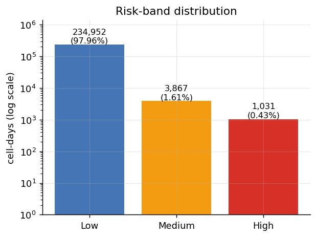 | 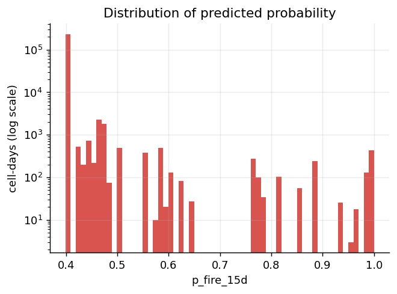 |
| 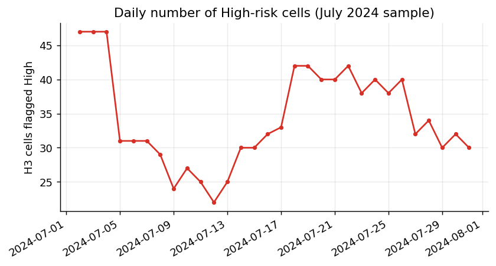 | 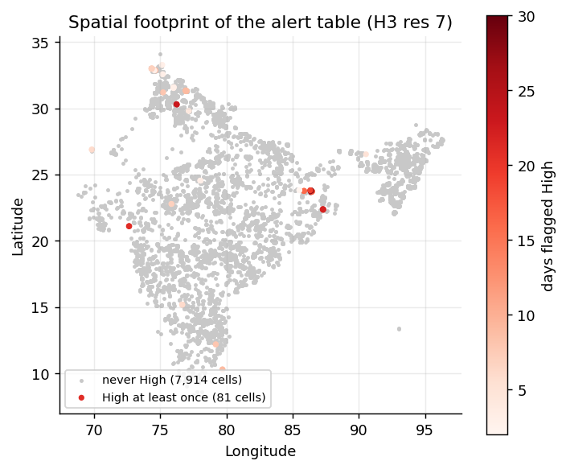 |

Observation: 96 % of scores sit in a narrow floor around 0.40, so only a very small, spatially concentrated set of cells
gets a high score — a sparse, actionable alert list rather than blanket warnings.

### C. Sentinel-2 burned-area maps (Punjab, 2024)
Red = detected burn signal (Earth Engine, Sentinel-2A).

| 21–25 Sep | 1–5 Oct | 11–15 Oct | 1–5 Nov |
|---|---|---|---|
| 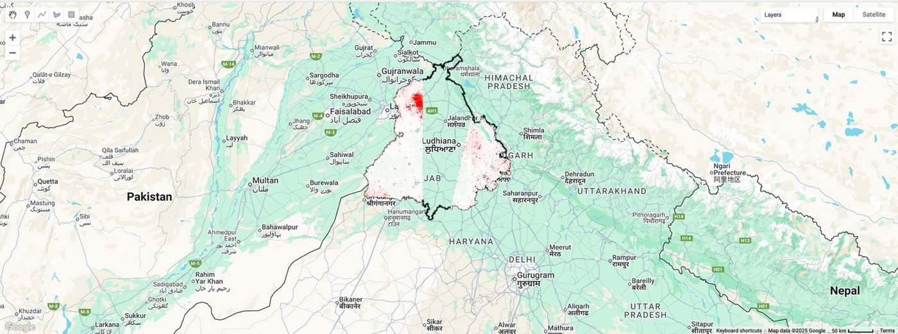 | 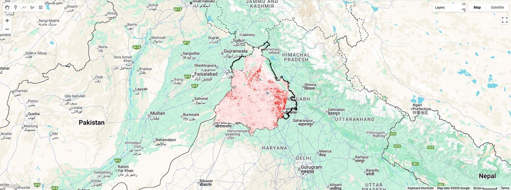 | 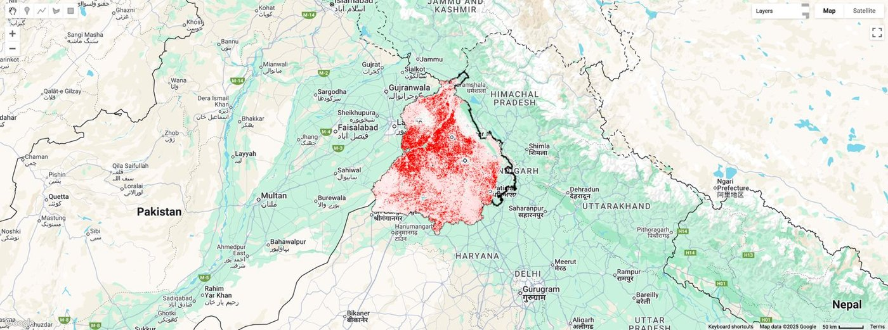 | 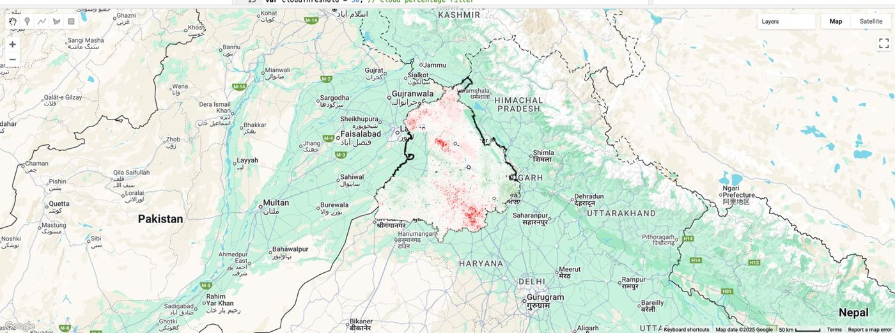 |

True-colour composites for the same windows (note the haze in early November):

| 21–25 Sep | 1–5 Oct | 11–15 Oct | 1–5 Nov |
|---|---|---|---|
| 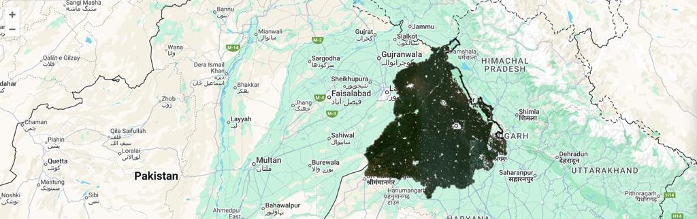 | 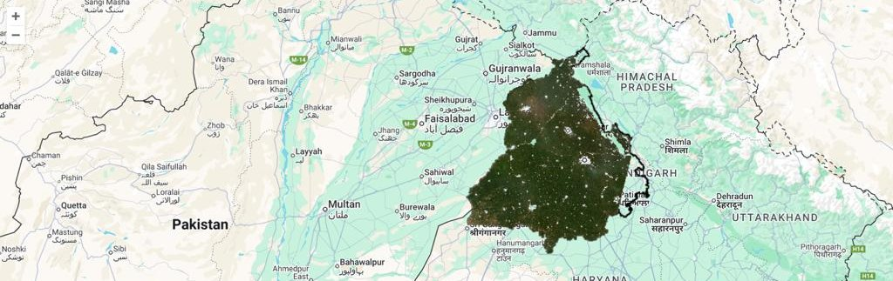 | 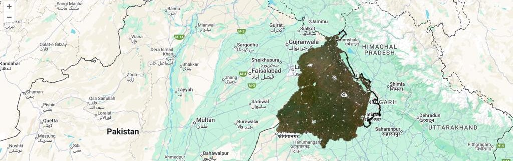 | 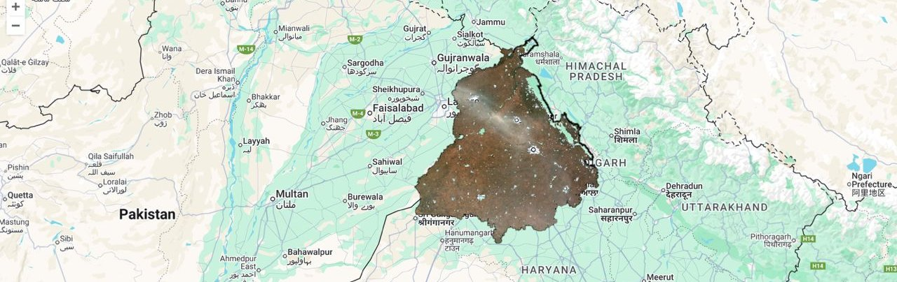 |

Predicted fire locations for 16 Nov 2024 (15-day forecast check):

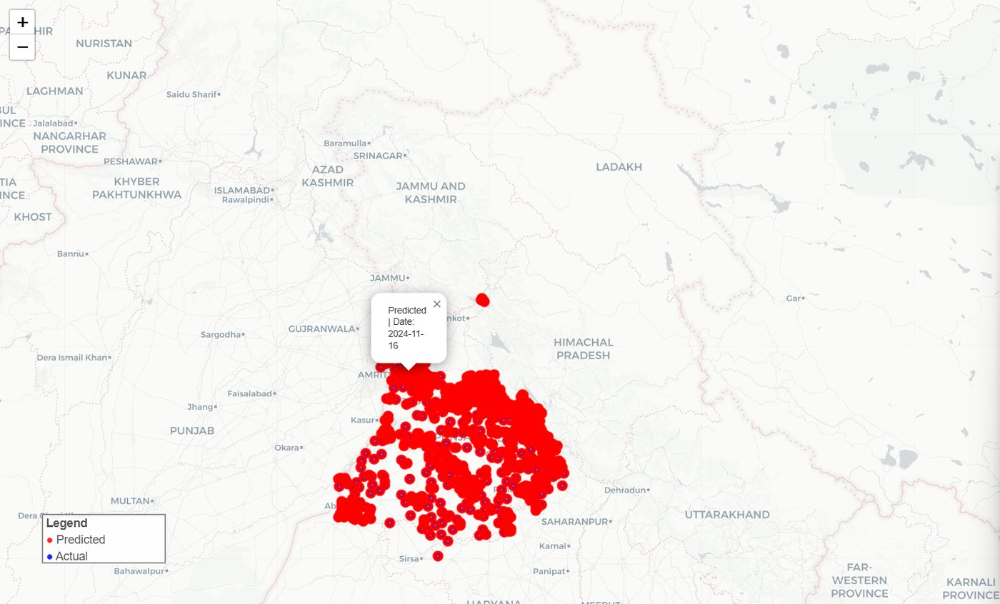

### D. ML pipeline demo output — ⚠ SYNTHETIC DATA
`python -m stubble_ews demo` runs the whole pipeline on a simulated Punjab fire season so anyone can verify it works
without downloading FIRMS data. **These numbers describe the simulator, not real fires — do not cite them.**
Saved output is in `docs/images/demo_synthetic/` and `docs/demo_metrics_SYNTHETIC.json`.

| | |
|---|---|
| 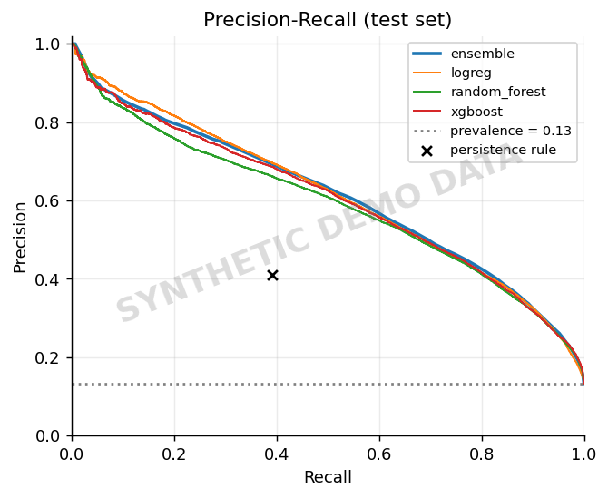 | 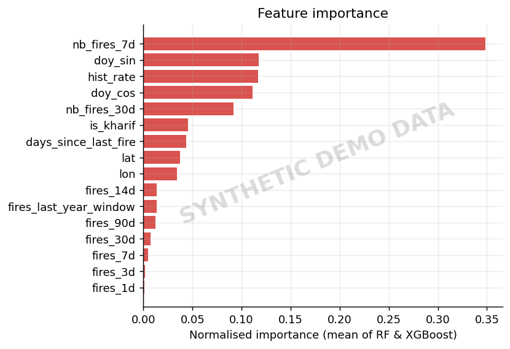 |

**Next step for real results:** download Punjab FIRMS data (see `docs/DATA.md`) and run `train` (below).

## 🖥 Screenshots
| Dashboard | Alerts table + e-mail panel |
|---|---|
| 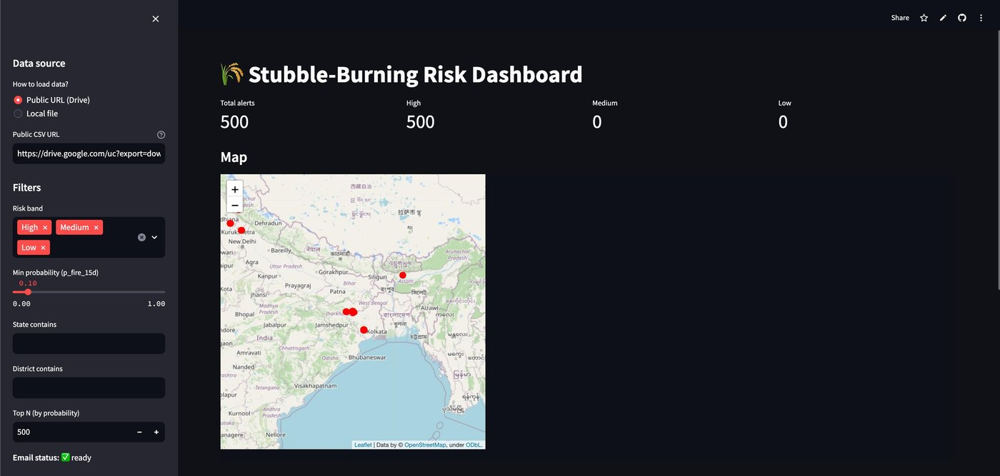 | 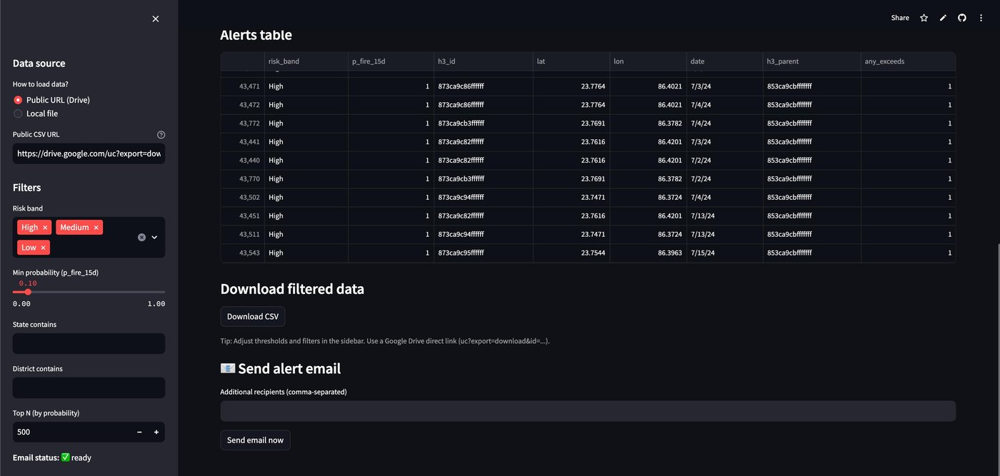 |

Automated Gmail alert (CSV + GeoJSON + HTML map attached; sender address blurred):

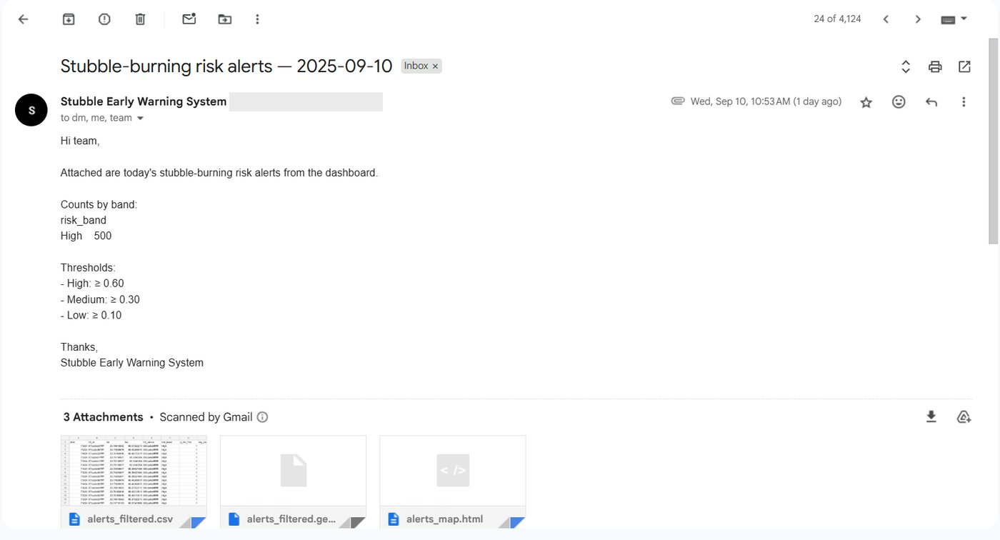

## 📁 Repository structure
```
├── README.md
├── pyproject.toml · requirements.txt · LICENSE · CITATION.cff
├── src/stubble_ews/          # NEW ML pipeline (data → features → models → evaluate → export)
├── tests/                    # 8 unit tests (leakage, labels, splits, thresholds, schema)
├── dashboard/                # ORIGINAL Streamlit app (unchanged) + 24 MB sample alerts CSV
├── earth_engine_apps/        # ORIGINAL Earth-Engine dashboards (need the owner's EE assets)
├── gee/                      # Sentinel-1/2 burned-area pipeline (third-party, attributed)
├── docs/                     # DATA.md, ML_PIPELINE.md, SOURCE_REPO_COMPARISON.md, images
├── reports/                  # alerts_summary.json + figures
├── data/raw/                 # put FIRMS CSVs here (git-ignored)
└── models/ · outputs/        # generated artefacts
```

## 🚀 Quick start
**1 · ML pipeline** (Python ≥ 3.10)
```bash
python -m venv .venv && source .venv/bin/activate
pip install -e ".[dev]"
pytest -q                                   # 8 tests
python -m stubble_ews demo                  # synthetic end-to-end run (~1 min)
python -m stubble_ews eda-alerts            # real EDA of the shipped alerts CSV
```
**2 · With real satellite data**
```bash
python -m stubble_ews train --firms data/raw/firms_punjab.csv \
       --train-end 2023-05-31 --val-end 2024-02-29        # set so each split contains an Oct–Nov season
python -m stubble_ews predict --firms data/raw/firms_punjab.csv --out-csv outputs/alerts_latest.csv
```
**3 · Dashboard** (use a separate virtual env — it pins older libraries)
```bash
cd dashboard
pip install -r requirements.txt
streamlit run app.py          # lower "Min probability" in the sidebar to see Medium/Low rows
```
Use your own pipeline output with `LOCAL_CSV_PATH=../outputs/alerts_latest.csv streamlit run app.py`.

**E-mail alerts** — set environment variables (never commit them): `SMTP_USER`, `SMTP_PASS` (a Gmail *app password*),
`RECIPIENTS=a@x.com,b@y.com`.

**4 · Satellite validation** — see [`gee/README.md`](gee/README.md) (needs a Google Earth Engine project).

## ⚠ Limitations (read this)
* The shipped alerts CSV is **all-India, July 2024** (not the Oct–Nov Punjab season) — it is for demonstration.
* Precision in the Nov 2024 check was **6 %**: most alerts were false alarms. Better features (weather, wind, crop
  calendar, Sentinel indices) are needed before operational use.
* The deck's accuracy figures are not informative on their own because fires are rare events.
* The original Colab model code is not in this repo; `src/stubble_ews` is a clean re-implementation, so it does not
  reproduce the deck's 94.2 % figure. Run it on real FIRMS data to obtain its own numbers.
* The two Earth-Engine apps depend on private assets and cannot run for other users.
* FIRMS detections are fire *events*, not measured burned area; the Punjab grid is a bounding box.

## 🔭 Future work
Real-time satellite ingestion · weather & wind features · LSTM/CNN spatio-temporal models · Sentinel + MODIS fusion ·
integration with government agencies · generative-AI scenario simulation for policy planning.

## 📚 References
1. Gorelick, N. et al. (2017). Google Earth Engine: Planetary-scale geospatial analysis for everyone. *Remote Sensing of Environment*, 202, 18–27.
2. Giglio, L., Schroeder, W., Justice, C. O. (2016). The collection 6 MODIS active fire detection algorithm and fire products. *Remote Sensing of Environment*, 178, 31–41.
3. Schroeder, W. et al. (2014). The new VIIRS 375 m active fire detection data product. *Remote Sensing of Environment*, 143, 85–96.
4. Drusch, M. et al. (2012). Sentinel-2: ESA's optical high-resolution mission for GMES operational services. *Remote Sensing of Environment*, 120, 25–36.
5. Key, C. H., Benson, N. C. (2006). Landscape assessment: remote sensing of severity, the Normalized Burn Ratio. In *FIREMON*, USDA Forest Service RMRS-GTR-164-CD.
6. Chen, T., Guestrin, C. (2016). XGBoost: A scalable tree boosting system. *KDD '16*.
7. Pedregosa, F. et al. (2011). Scikit-learn: Machine learning in Python. *JMLR*, 12, 2825–2830.
8. Saito, T., Rehmsmeier, M. (2015). The precision-recall plot is more informative than the ROC plot when evaluating binary classifiers on imbalanced datasets. *PLoS ONE*, 10(3).
9. Zanaga, D. et al. (2022). *ESA WorldCover 10 m 2021 v200*. Zenodo.
10. NASA FIRMS — https://firms.modaps.eosdis.nasa.gov · Uber H3 — https://h3geo.org
11. Saratkar, S., Ravulapati, H. (2025). *Stubble-Burning Risk Assessment with Alert System* (internship presentation, guide Dr. Jaya Saxena).

## 👥 Credits & licence
* **Authors:** Saniya Saratkar ([@Saniya1312S](https://github.com/Saniya1312S)) · Havish Ravulapati · Guide: Dr. Jaya Saxena.
* `gee/punjab_stubble_pipeline.py` is third-party code (*Joy Jordan*, repo `stubble_mainn`, MIT) included with attribution.
* Released under the [MIT License](LICENSE).
